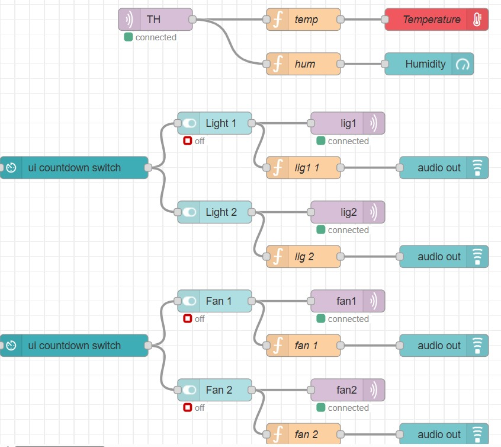

# Automatic Power Consumption Reduction System

## Project Overview

The Automatic Power Consumption Reduction System is an IoT-based energy management project designed to reduce unnecessary electricity usage in classrooms, laboratories, and other buildings.

The system uses a webcam and a machine learning model to detect and count people. MQTT communication and Node-RED are used for dashboard monitoring and automated control of lights and fans.

## Problem Statement

Unnecessary use of electrical appliances in classrooms and other campus facilities leads to energy wastage and increased electricity costs.

## Proposed Solution

The system detects room occupancy and uses automation rules to control electrical appliances according to the number of people present.

## Technologies Used

- Python
- OpenCV
- MobileNet SSD
- Raspberry Pi
- MQTT
- Node-RED
- ESP8266 / ESP32, if used in the hardware implementation
- DHT11 temperature and humidity sensor

## System Workflow

1. A webcam captures the room.
2. The MobileNet SSD model detects and counts people.
3. Python publishes the people count to an MQTT broker.
4. Node-RED displays the live people count.
5. Node-RED applies automation rules.
6. MQTT messages control the lights and fans.

## Devices Controlled

- Light 1: `lig1`
- Light 2: `lig2`
- Fan 1: `fan1`
- Fan 2: `fan2`

## Monitoring

The Node-RED dashboard includes temperature and humidity displays, device switches, and MQTT-connected nodes.

## Node-RED Dashboard

The Node-RED flow includes temperature and humidity monitoring, switches for lights and fans, and MQTT communication.



## Hardware Components

- Raspberry Pi
- Webcam
- Relay module
- Lights and fans
- DHT11 sensor
- ESP8266 / ESP32, if used
- Connecting wires and suitable power supplies

## Project Structure

```text
Automatic-Power-Consumption-Reduction/
├── code/
│   └── person_detection_mqtt.py
├── docs/
│   ├── workflow.md
│   └── node-red-flow.md
├── hardware/
│   └── components.md
├── models/
│   ├── MobileNetSSD_deploy.caffemodel
│   ├── MobileNetSSD_deploy.prototxt
│   └── README.md
├── README.md
├── requirements.txt
└── node-red-flow.png
```

## Future Enhancements

- Improved people-counting accuracy
- Remote monitoring and control
- Energy consumption analysis
- Smart energy optimization
- Predictive maintenance

## Project Status

Project documentation and code are being organized. Hardware functionality and integration should be verified through testing.
